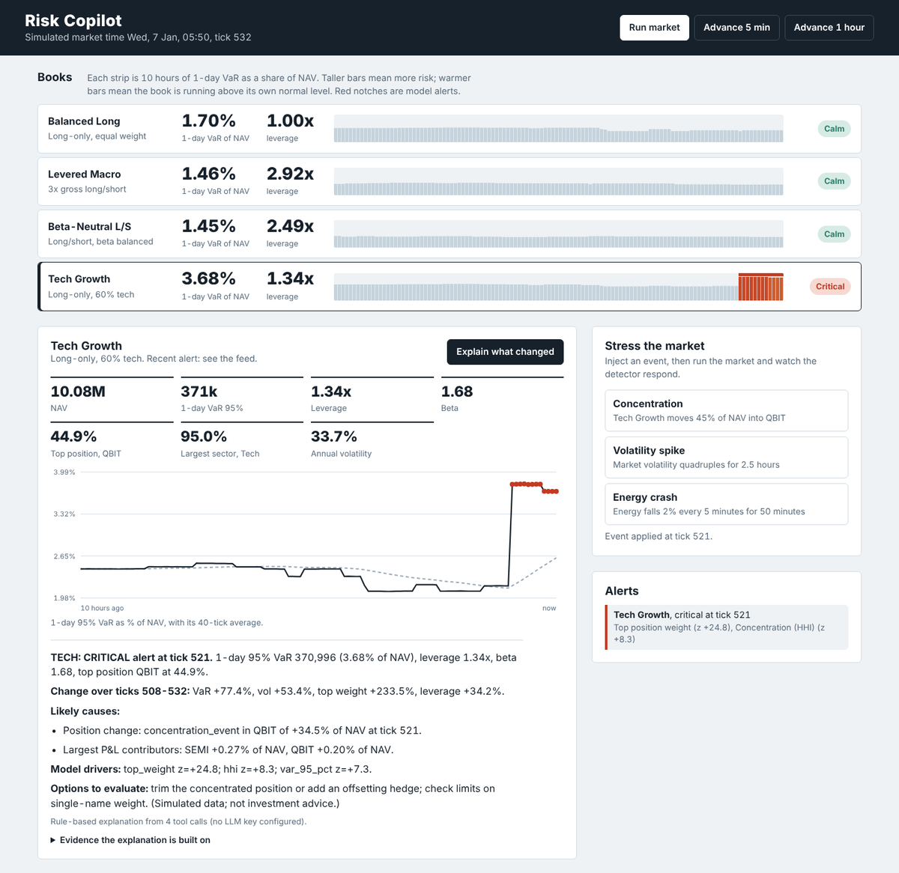

# AI Trading Risk Copilot

Simulated multi-portfolio trading book → real-time risk engine → ML anomaly detection → LLM agent that explains
*why* risk changed, served by FastAPI on top of a SQL analytics layer.

```
MarketSimulator ─► RiskEngine (per 5-min tick) ─► SQLite ◄──── SQL analytics (window fns, joins)
 (factor model)     positions · VaR · vol ·         prices, trades,        │
                    concentration · sectors         risk_snapshots,        ▼
                          │                         sector_exposures,   RiskTools (6 read-only tools)
                          ▼                         alerts                  │
                 RiskAnomalyDetector                                        ▼
        (per-portfolio robust z + IsolationForest)        RiskAgent: Claude / OpenAI tool-use loop
                          │                                     (deterministic fallback, same tools)
                          └──────────────► alerts ───────────────────────┐
                                                                         ▼
                                                     FastAPI (/score /explain /alerts ...)  +  MCP server
```

## Quick start
```bash
pip install -r requirements.txt
python -m scripts.seed                       # simulate history, train + save the detector
uvicorn app.main:app --port 8000             # dashboard at http://localhost:8000 (RISK_SIM_INTERVAL=2 to tick live every 2s)
export ANTHROPIC_API_KEY=...                 # optional: enables the LLM agent with Claude
# or: export OPENAI_API_KEY=... RISK_LLM_PROVIDER=openai   (model override: RISK_LLM_MODEL)

curl -X POST localhost:8000/simulation/inject -H 'content-type: application/json' \
  -d '{"kind":"concentrate","portfolio_id":"TECH","symbol":"QBIT","target_weight":0.45}'
curl -X POST 'localhost:8000/simulation/step?n=3'
curl localhost:8000/alerts
curl -X POST localhost:8000/portfolios/TECH/explain
python -m pytest -q                          # 31 unit/integration tests (unittest-compatible)
python -m scripts.evaluate 5                 # detector evaluation
docker build -t risk-copilot . && docker run -p 8000:8000 risk-copilot
```

## Dashboard


`http://localhost:8000` serves a single-page dashboard (plain HTML, CSS and JavaScript, no build step) on top of the same API:
- **Books**: one row per portfolio with VaR, leverage and a 10-hour *risk tape*. Bar height is VaR as a share of NAV on a
  scale shared by every book; bar colour shows how far the book is running above its own median; red notches mark alerts.
- **Run the market**: play/pause or step 5 minutes or an hour at a time, and inject a concentration trade, a volatility
  spike or an Energy crash to watch the detector respond.
- **Explain what changed**: calls `/explain` and shows the explanation with the tool outputs it was built from.
- **What if, right now**: instant P&L of the selected book under seven standard shocks, with the three biggest losers in
  each, plus a builder for your own market and sector move.

## Stress tests
`app/stress.py` applies each position's shocked return, `beta × market move + sector move`, to its current market value.
This is the same factor structure the simulator uses. It is a linear, instantaneous shock with no second-order effects,
liquidity costs or re-hedging, so treat it as a first read rather than a full scenario engine.

## Validation
- The core service layer is framework-independent and covered by unit tests.
- The FastAPI adapter is also exercised with `fastapi.testclient.TestClient`, covering health, portfolio/risk reads, validation, stateless scoring, explanations, and simulation controls.
- The LLM path uses scripted fake clients in tests (Claude-style and OpenAI function-calling); no live API key is required.
- Stress maths (linearity, symmetry, sector isolation), validation and the dashboard endpoints have their own tests.
- The MCP server is tested end to end with an in-memory MCP client (tool listing, calls and error handling).
- GitHub Actions runs the test suite and the detector evaluation on every push and pull request.

## API
| Endpoint | Purpose |
|---|---|
| `GET /health` | tick, model loaded, agent mode (`llm` / `rule_based`) |
| `GET /portfolios`, `GET /portfolios/{id}/risk`, `/history?n=` | latest metrics; history with SQL rolling averages |
| `POST /score` | stateless model inference: feature vector → anomaly score, severity, drivers |
| `POST /portfolios/{id}/explain` | agent explanation + the tool outputs it used (`evidence`) |
| `GET /alerts?portfolio_id=&severity=` | alert log with drivers |
| `GET /analytics/summary` | cross-portfolio SQL analytics (VaR rank, alert counts, VaR change vs N ticks ago) |
| `GET /portfolios/{id}/stress` | P&L under the standard market and sector shocks, with worst contributors |
| `POST /portfolios/{id}/stress` | the same for up to 20 custom scenarios (`market`, `sectors`, each between -90% and +90%) |
| `GET /dashboard/overview?n=` | every book's latest snapshot, sector weights, recent history and the alert feed in one call |
| `POST /simulation/step`, `/simulation/inject` | advance the market; inject `concentrate` / `vol_spike` / `sector_crash` |

## MCP server
`python -m app.mcp_server` exposes the copilot over the Model Context Protocol (stdio), so any MCP client (Claude Desktop,
IDE agents, a custom agent) can query it. Tools: `list_portfolios`, `get_latest_snapshot`, `get_risk_history`,
`get_positions`, `explain_change`, `get_market_context`, `get_similar_alerts` and `explain_portfolio_risk`. They are the
same read-only tools the built-in agent uses; none of them trades, injects events or writes to the database.

```json
{"mcpServers": {"risk-copilot": {"command": "python", "args": ["-m", "app.mcp_server"], "cwd": "/path/to/ai-risk-copilot"}}}
```

## Design decisions
- **Risk metrics** (`app/risk.py`): NAV, gross/net, leverage, beta, historical-simulation VaR 95/99 on *current weights*
  over a 120-tick window (scaled to 1 day by √time), annualised vol, window drawdown, top-position weight, HHI, sector exposure.
- **Anomaly model** (`app/anomaly.py`): each portfolio is scored against *its own* baseline (robust z-scores, median/MAD),
  so a 3x-levered fund isn't judged by a long-only fund's normal. IsolationForest runs on the pooled z-scores. An alert
  requires a low forest score **and** a feature beyond 4σ, and every alert carries its top drivers.
  Scales have per-feature *materiality floors* (e.g. beta 0.05): without them a beta-neutral book's near-zero baseline
  turned ordinary weight drift into false alarms (I hit this: 7% of clean snapshots flagged before the floors, 0% after).
- **Alert hygiene**: 20-tick cooldown per portfolio, bypassed on escalation or a *new* driver feature.
- **Agent** (`app/agent.py`, `app/tools.py`, `app/llm_clients.py`): one tool-use loop for both providers. Claude runs through
  the Anthropic SDK; OpenAI models run through an adapter that maps the loop to Chat Completions function calling. The LLM never sees raw tables; it calls tools (latest snapshot, `explain_change`
  = metric deltas + trades + P&L attribution + weight/sector deltas, market context, similar past alerts). The system prompt
  requires every number to come from a tool result. Without an API key, or if the API errors, a deterministic explainer
  runs the same tools, so `/explain` always answers and always returns its evidence.
- **SQL layer** (`sql/schema.sql`, `sql/analytics.sql`): positions are *derived* from the trade ledger (`v_positions`,
  point-in-time queries), so any past state is reconstructable. Analytics use window functions (`RANK`, rolling `AVG OVER`) and self-joins.

## Measured behaviour (`python -m scripts.evaluate 5`; 5 seeds, train on 400 clean ticks)
| | result |
|---|---|
| False positives, 8,000 clean held-out snapshots | 0 flagged |
| Concentration event (TECH → 45% in one name) | 5/5 detected, same tick |
| 4x volatility spike for 30 ticks | 5/5 detected, 3-9 ticks (15-45 min) |
| Energy −20% sector crash | 5/5 detected, 3-9 ticks |
| Energy −8% sector crash | **not detected** (a P&L shock, not a change in risk exposure; see below) |

## Known limitations
- Data is simulated with a Gaussian factor model, no fat tails, no volatility clustering; the numbers above show the
  pipeline works, not that it would perform on real markets. Real use needs backtests on real history.
- Detection is only as good as the baseline: the model is trained on clean data and doesn't adapt to regime change.
  Retrain (`python -m scripts.seed`) or add scheduled retraining before relying on it.
- The detector watches *risk-exposure* metrics, so mild loss events that don't move vol/VaR/concentration are invisible to it.
  A P&L/drawdown limit monitor would complement it.
- The LLM path is covered by a scripted fake client in tests (tool loop, tool_result wiring, error fallback), not by live API calls.
- SQLite single-writer is fine for a simulator; use Postgres/TimescaleDB for real throughput (the SQL is standard apart from `?` param style).
- Stress tests are linear in beta and sector; options, convexity and correlation breakdowns are not modelled.
- No auth or rate limiting on the API.
